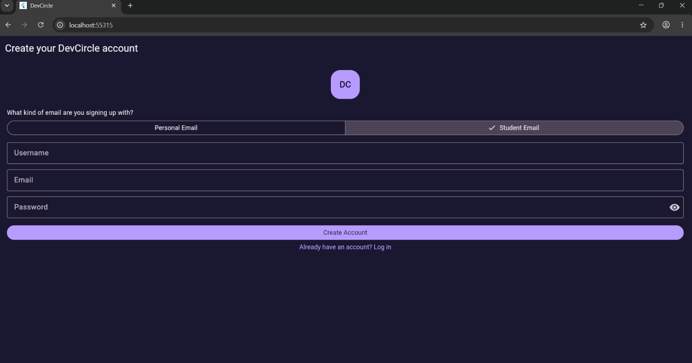
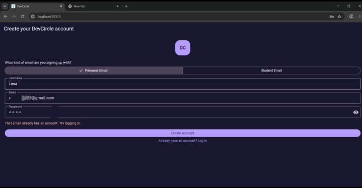
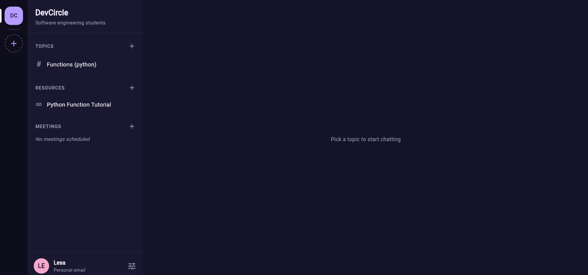
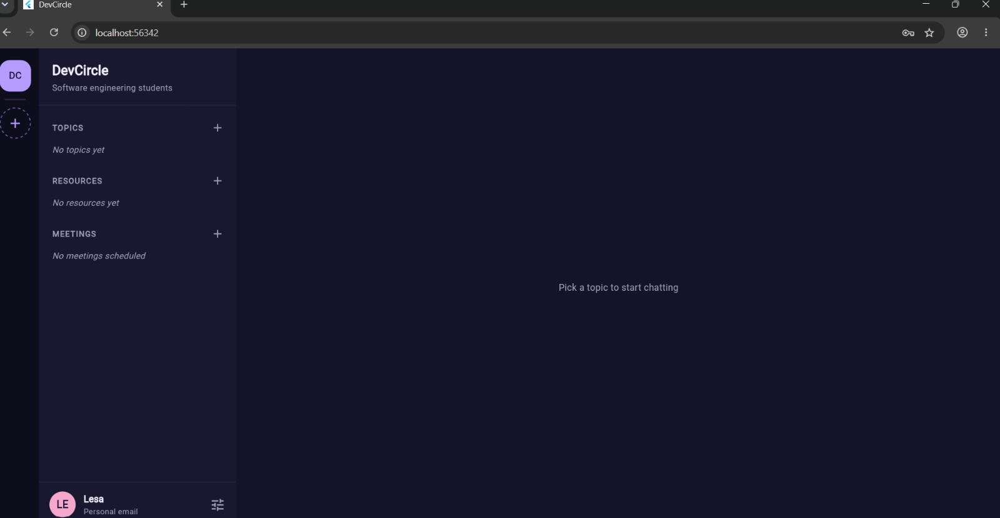
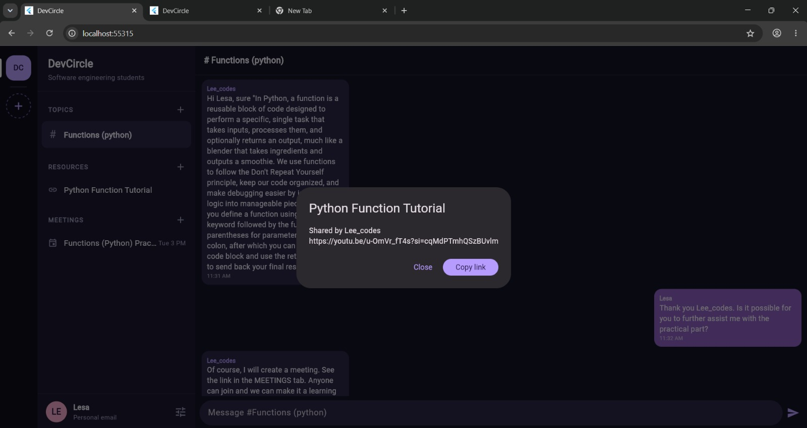
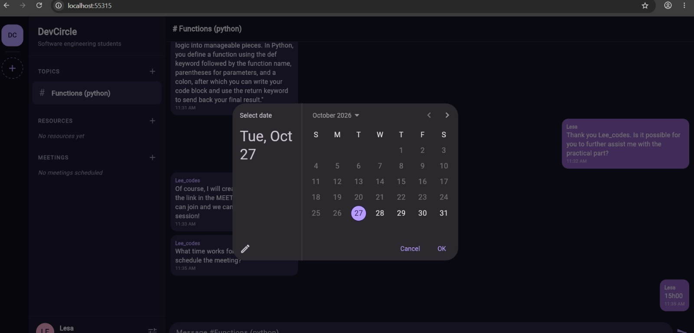
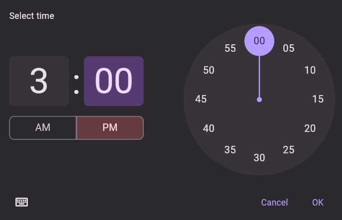
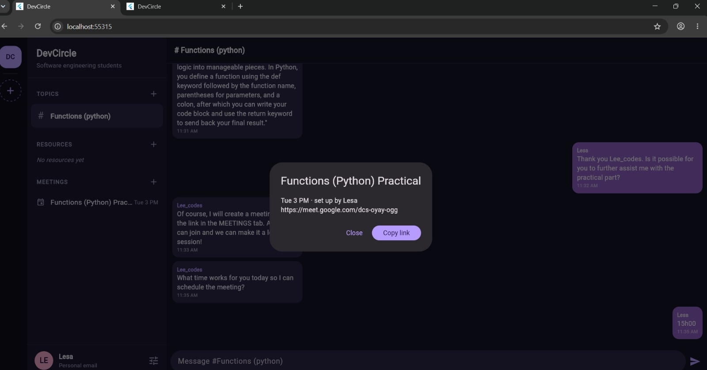
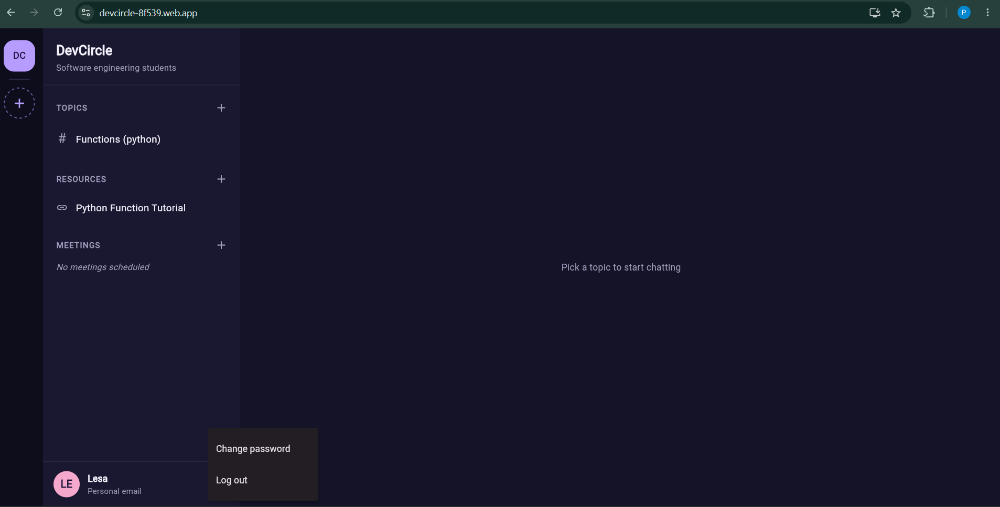
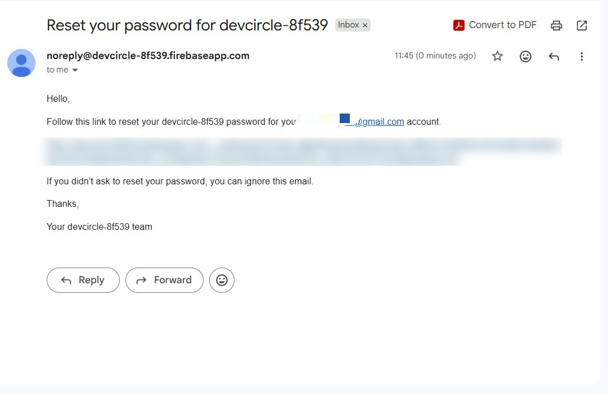

# DevCircle Auth - Track 2: Firebase with Flutter

**DevCircle** is a mini Discord for software engineering students. This repository is my **Track 2** submission and the **live, working app**.
People create accounts, log in, reset forgotten passwords, and chat in topics. **Everything is stored online, so a new user sees the full chat history.**

| | |
|---|---|
| **Live app (try it now)** | [https://devcircle-8f539.web.app/](https://devcircle-8f539.web.app/) |
| **Courses used** | [Firebase FCM Flutter codelab](https://firebase.google.com/codelabs/firebase-fcm-flutter) (Track 2), [Flutter first codelab](https://codelabs.developers.google.com/codelabs/flutter-codelab-first) (Track 1, in `devcircle-ui`) |
| **Student** | Palesa |
| **Reference code** | WTC-7WFDKS75 |
| **Built with** | Flutter (Dart), Firebase Authentication, Cloud Firestore, Firebase Cloud Messaging, Firebase Hosting |

**Contents:** [Problem](#the-problem-it-solves) · [Features](#what-the-app-does) · [Try it](#try-it-yourself) · [Devices](#where-it-works) · [Screenshots](#screenshots-what-each-one-shows) · [Tests](#how-to-run-the-tests-and-checks) · [Security](#security-and-privacy) · [Files](#project-files) · [Limits](#limits-and-future-work) · [Learned](#what-i-learned)

## The problem it solves
Students study in many places. Questions are asked in WhatsApp groups, links get lost in long chats, meeting invitations are buried, and a student who joins late cannot see what was discussed before. DevCircle puts it all in one place: **topics to talk in, shared resources, study meetings, and a chat history every new member can read from the beginning.**

## What the app does
| Feature | Details |
|---|---|
| **Sign up** | Username, email, password; choose *Student* or *Personal* email (Firebase Authentication). |
| **Log in / log out** | Friendly errors: wrong password, no internet, too many attempts, email already used. |
| **Forgot password** | "Forgot password?" emails a reset link; the user opens it and creates a new password. Logged-in users can use the three-line icon, then *Change password*. |
| **Shared chat** | Topics, messages, resources and meetings are stored in **Cloud Firestore**. Everyone sees the same data and new messages appear instantly. |
| **Chat history** | A new user sees every earlier message. The newest 100 load first; "Load older messages" loads more. |
| **Unread badges** | A pink badge shows how many messages you have not opened yet. |
| **Resources and meetings** | Share links; schedule a meeting with a link, a date and a time. |
| **Push notifications (FCM)** | Asks permission, saves the device token, shows a banner for messages that arrive while the app is open, and has a background handler. |
| **Security rules** | Profiles are private and only signed-in users can read chat data. |
| **Starts empty** | No sample data and no pre-made accounts. The first users created everything. Students are now using the live app, so a new user sees existing topics and chat history. |


## Try it yourself
1. Open the live app: https://devcircle-8f539.web.app/
2. Press **Create Account**, choose *Personal* or *Student* email, and enter a username, email and password (at least 6 characters).
3. You land on the home screen. Open the topic **Functions (python)** and scroll up: you can read the whole earlier conversation.
4. Press **+** next to TOPICS to start your own topic and send a message. Other users see it instantly.
5. Press **+** next to RESOURCES to share a link, or **+** next to MEETINGS to schedule a meeting.
6. Forgot your password? On the log in screen press **Forgot password?**. To change it later use the three-line icon at the bottom left, then **Change password**.

## Where it works
| Platform | Status |
|---|---|
| Web (Chrome, Edge, Firefox, Safari) | Works. This is the live link above, on phones too. |
| Android | Works (an APK can be built with Flutter). |
| iOS | Supported by Firebase and Flutter, but building needs a Mac and an Apple developer account. |
| Windows / Linux desktop | Not supported by this Firebase setup. Use the web link. |

## Security and privacy
- Passwords are handled by **Firebase Authentication**. The app never stores or sees them.
- **Firestore security rules** make user profiles private, allow only signed-in users to read chat data, and require every message to carry the sender's own id.
- Notifications are optional. If the browser blocks them the app still works (you may see a harmless "FCM setup skipped" note in the developer console).

## Screenshots (what each one shows)

### 1. Sign up screen


**What it shows:** the first screen a new student sees. They choose **Personal Email** or **Student Email**, then type a username, an email and a password, and press **Create Account**. Firebase Authentication creates the account.

### 2. Email already in use


**What it shows:** form validation. If someone signs up with an email that already has an account, the app shows a clear message: *"That email already has an account. Try logging in."* instead of crashing.

### 3. Home screen of the live app


**What it shows:** the main screen after logging in, on the live app. On the left are the **circle** (DC), then **TOPICS**, **RESOURCES** and **MEETINGS**. Students are already using the app: it has a topic (*Functions (python)*) and a shared resource (*Python Function Tutorial*). The **+** buttons add new items. The user name and email type are at the bottom left.

### 4. Day one: the app starts empty


**What it shows:** how the app looked when it was first launched: *No topics yet*, *No resources yet*, *No meetings scheduled*. Nothing is pre-made. Everything is created by real students.

### 5. Shared chat with two users, and a resource


**What it shows:** two different students (`Lesa` and `Lee_codes`) chatting in the topic **Functions (python)**. Messages from other people are on the left, my own on the right. The pop-up shows a shared resource: who shared it, the link, and a **Copy link** button. Because everything lives in Cloud Firestore, a new message appears instantly for everyone.

### 6. Scheduling a meeting: pick the date


**What it shows:** step 1 of adding a meeting (**+** next to MEETINGS): choosing the date from a calendar.

### 7. Scheduling a meeting: pick the time


**What it shows:** step 2: choosing the time (here 3:00 PM).

### 8. Meeting details


**What it shows:** the meeting now appears under **MEETINGS** for everyone. Clicking it shows the day and time, who set it up, and the video call link with a **Copy link** button.

### 9. Account menu


**What it shows:** the three-line icon next to the user name (bottom left) opens **Change password** and **Log out**. The line under the name shows whether the account uses a **Personal email** or a **Student email**. The address bar shows the live link.

### 10. Forgot password: the reset email


**What it shows:** after pressing **Forgot password?** and entering their email, the student receives this email from Firebase with a reset link (the link is blurred here).

### 11. Forgot password: choose a new password


**What it shows:** the link opens Firebase's page where the student types a **new password** and presses **Save**. They can then log in with it.

## How to run the tests and checks
Run these inside the `devcircle-auth` project folder (you need Flutter installed):

```bash
flutter pub get          # download packages (first time only)
flutter analyze          # checks the code for mistakes. Expected: "No issues found!"
flutter test             # runs everything in the test/ folder. Expected: "All tests passed!"
```

| Command | What it does |
|---|---|
| `flutter test` | Runs all tests in `test/` |
| `flutter test test/widget_test.dart` | Runs just one test file |
| `flutter test --reporter expanded` | Shows the name of every test as it runs |
| `flutter test --coverage` | Also writes a coverage report to `coverage/lcov.info` |

**What is tested:** `test/widget_test.dart` is a small starter test. The app talks to Firebase (a live online service), so the main checks are done by hand on the live app: sign up, chat between two users, chat history, resources, meetings and password reset (see the screenshots above). Firebase security rules can also be tried in the Firebase console under Firestore -> Rules -> **Rules Playground**.

**If a test fails:** read the first red error line, run `flutter pub get` and try again.

## Project files
| File | Purpose |
|---|---|
| `lib/main.dart` | Starts Firebase, FCM background handler, `AuthGate` (shows login or app) |
| `lib/signup_page.dart`, `login_page.dart`, `forgot_password_page.dart`, `password_field.dart` | Account screens |
| `lib/home_page.dart` | Main screen: circles, user card, settings menu |
| `lib/sidebar.dart` | Live topics / resources / meetings with unread badges |
| `lib/chat_view.dart` | Live chat for one topic |
| `lib/helpers.dart`, `theme.dart`, `shell_widgets.dart` | Dialogs, dark theme, reusable widgets |
| `lib/notification_service.dart` | Push notification setup |
| `lib/firebase_options.dart` | Firebase connection settings (generated) |
| `firestore.rules` | Database security rules |

## Limits and future work
- Push notifications are sent from the Firebase console. Sending one automatically for every new message needs Cloud Functions (not included).
- No moderation yet (no edit or delete), and the student-email choice is not verified.
- Windows and Linux desktop are not supported by this Firebase setup. Use the web version there.
- Firebase's free plan has daily read/write limits.
- **Future work:** edit and delete messages (moderation), email verification for student accounts, editing topics/resources/meetings, and automatic push notifications with Cloud Functions.

## What I learned
- Firebase Authentication: sign up, log in, password reset, and `authStateChanges()` to switch screens automatically.
- Cloud Firestore: saving data, live `snapshots()` streams, and why security rules matter.
- Push notifications: permission, device token, foreground and background messages.
- How a database design (circles, topics, messages) lets every user share the same history.
-----------------------------------------------------------------------------------------------------------------
WTC-7WFDKS75
